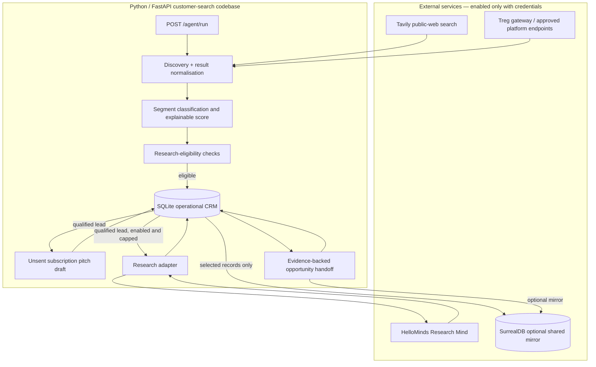
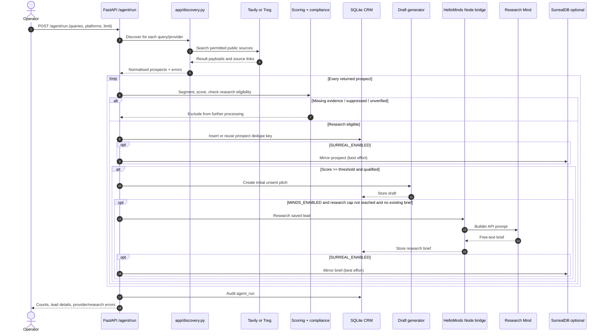
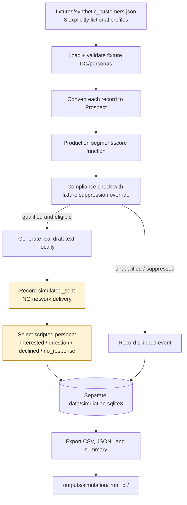
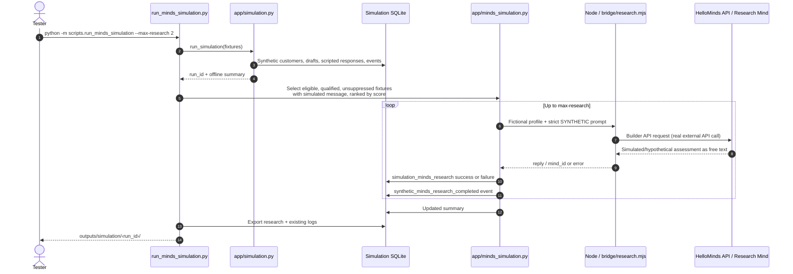
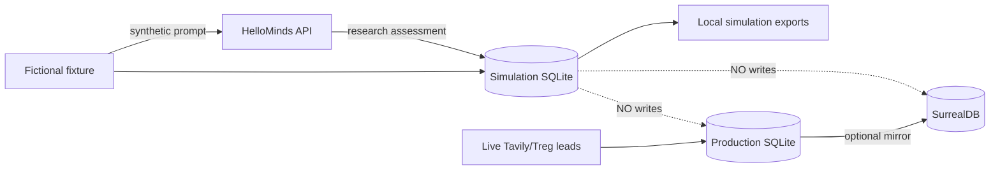
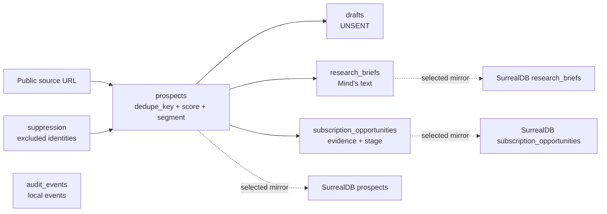

> **Updated workflow note:** The research-first prospect acquisition update supersedes parts of this historical architecture document, including the order of draft creation and the previous weighting of lead scoring. Use [CUSTOMER_ACQUISITION_RESEARCH_FIRST.md](CUSTOMER_ACQUISITION_RESEARCH_FIRST.md) for the current behaviour and annotated figures.

# Social Trend Customer Search Agent — Codebase Architecture and Data Flows

**Documentation version:** 1.0 · **Codebase inspected:** `social-trend-agent-hellominds-daytona-simulation.zip` (10 November 2026)  
**Scope:** prospect discovery, lead qualification, optional HelloMinds research, subscription opportunity tracking, offline simulation, HelloMinds-powered synthetic simulation, and Daytona execution.  
**Product hypothesis:** **£7 GBP per month** for **daily social trend insights**, targeting **small businesses, early-stage startups, and independent influencers/creators**.

> **Read this first:** This repository is a **customer-acquisition and testing MVP**, not a completed subscription SaaS. It does **not** send real outreach, process Stripe payments, schedule daily insights, serve the paid analytics dashboard, or create real subscriptions. Synthetic messages and customer replies are not real-world activity or proof of demand.

## Contents

1. [What the project does](#1-what-the-project-does)
2. [System boundary and architecture](#2-system-boundary-and-architecture)
3. [Codebase inventory](#3-codebase-inventory)
4. [Configuration](#4-configuration)
5. [Live discovery and research flow](#5-live-discovery-and-research-flow)
6. [Offline local customer simulation](#6-offline-local-customer-simulation)
7. [HelloMinds-powered synthetic simulation](#7-hellominds-powered-synthetic-simulation)
8. [Daytona sandbox execution flow](#8-daytona-sandbox-execution-flow)
9. [Data models, tables and logs](#9-data-models-tables-and-logs)
10. [API endpoints](#10-api-endpoints)
11. [Testing and verification](#11-testing-and-verification)
12. [Important implementation limitations](#12-important-implementation-limitations)
13. [Troubleshooting](#13-troubleshooting)
14. [Suggested next development steps](#14-suggested-next-development-steps)

---

## 1. What the project does

The agent is designed to discover public, business-level signals suggesting a small business, startup, or professional creator could benefit from ongoing trend insights. It assigns explainable scores, screens basic research eligibility, prepares **unsent** acquisition drafts, optionally asks a HelloMinds Research Mind to prepare a research brief, and records leads and explicitly evidenced subscription opportunities.

**Three distinct execution paths exist:**

| Path | Inputs | External requests | CRM writes | Customer contact | Purpose |
|---|---|---|---|---|---|
| **Live acquisition** | Tavily web search and configured Treg providers | Tavily/Treg; optional HelloMinds and SurrealDB | SQLite production CRM; optional SurrealDB mirror | **None** | Find and research real potential subscribers |
| **Offline simulation** | `fixtures/synthetic_customers.json` | **None** | Separate simulation SQLite DB | **None**; messages marked `simulated_sent` | Regression-test qualification, drafts and scripted reactions |
| **HelloMinds synthetic simulation** | Same fictional fixtures | **HelloMinds only** (when configured) | Separate simulation SQLite DB | **None**; customer reactions remain scripted | Verify research integration using fictional subjects |

Daytona is a **place to run** the latter paths in an isolated cloud sandbox; it is not itself a discovery, social research, or buyer-prediction service.

### Product vs implementation

| Product requirement | Current implementation |
|---|---|
| £7 monthly subscription | Configuration, draft wording, opportunity fields |
| Daily trend insights | Described in prompts and configuration; **no daily scheduler or analytics delivery** |
| Startups, small businesses, influencers | Keyword-based discovery, segmentation and qualification |
| Multiplatform signals | Tavily web search; Treg adapter slots for Instagram, TikTok, LinkedIn, Reddit, X, YouTube |
| Prospect research | HelloMinds Builder API bridge, conditional on account access |
| Shared agent memory | Optional SurrealDB **mirror** of selected production records |
| Customer behaviour testing | Scripted fictional customer responses |
| Actual subscriber acquisition | Opportunity tracking only; not billing or payment confirmation |

## 2. System boundary and architecture



**Important sequencing detail:** in `app/pipeline.py`, `create_draft()` is called **before** optional `research_lead()`. HelloMinds results are stored for later inspection, but they **do not automatically revise that already-created draft**. The research prompt also requests verified sourcing, but returned free text is not fact-checked by code.

**Operational source of truth:** SQLite. SurrealDB receives best-effort selected copies (prospects, research briefs and opportunities); it is not queried as the primary CRM in this version. If mirroring fails, the live pipeline records an error while preserving the local SQLite result.

**No external messaging integration exists.** Even when discovery is set to `live_search`, `eligible_for_outreach` is always `false` in the current compliance function.

## 3. Codebase inventory

The archive has the following relevant components (paths relative to `social-trend-customer-agent/`):

### Python application

| Path | Responsibility | Key inputs / outputs |
|---|---|---|
| `app/config.py` | Loads `.env` and validates settings using Pydantic | `Settings`, `get_settings()` |
| `app/models.py` | Request/prospect schemas | `Prospect`, `RunRequest`, `InterestRequest` |
| `app/targeting.py` | Default search queries and three target segments | `DEFAULT_QUERIES`, `segment_for()`, `subscription_fit()`, `buyer_need()` |
| `app/discovery.py` | Calls Tavily and Treg; normalises available result fields | `discover()`, `tavily_search()` |
| `app/treg.py` | Configurable gateway request for each social source | `call_platform()` |
| `app/scoring.py` | Calculates 0–100 fit and explainable reasons | `score_item()` |
| `app/compliance.py` | Checks basic public evidence, identity and suppression | `check_prospect()`; outbound eligibility always false |
| `app/drafts.py` | Builds **unsent** £7/month pitch | `create_draft()` |
| `app/pipeline.py` | Orchestrates live discovery, scoring, drafting, optional Minds and mirror | `run_pipeline()` |
| `app/hellominds.py` | Builds research prompt; starts Node bridge subprocess | `research_prompt()`, `research_lead()` |
| `app/surreal_store.py` | Best-effort deterministic-ID upserts to SurrealDB | `mirror_record()`, `mirror_prospect()`, `mirror_research()` |
| `app/database.py` | Operational SQLite schema, deduplication, research/opportunity storage and audit | `init_db()`, `save_prospect()`, `save_research()`, `save_interest()` |
| `app/main.py` | FastAPI endpoints and optional `X-Agent-Key` middleware | `/agent/run`, `/leads`, `/research`, etc. |
| `app/simulation.py` | Fully offline fixture-driven customer/message/response simulation | `run_simulation()`, `export_simulation()` |
| `app/minds_simulation.py` | Adds live HelloMinds research for selected **fictional** fixtures | `run_minds_simulation()`, `export_minds_simulation()` |

### Executables, fixtures and integration bridge

| Path | Responsibility |
|---|---|
| `scripts/run_simulation.py` | CLI for fully offline simulation and exports |
| `scripts/run_minds_simulation.py` | CLI for HelloMinds-powered synthetic simulation |
| `scripts/run_daytona_minds.py` | Creates Daytona sandbox, uploads ZIP, installs packages, runs tests and simulation, downloads logs, deletes sandbox |
| `bridge/research.mjs` | Official HelloMinds Node client: ensure conversation, send prompt, wait for reply |
| `bridge/package.json` | Node dependency declaration |
| `fixtures/synthetic_customers.json` | Eight invented customer profiles and expected response personas |
| `config/platform_payloads.json` | Example placeholder config; **not read by the current Treg adapter** |
| `requirements.txt` | Python dependencies; Daytona SDK may require separate installation on runner machine |
| `tests/` | pytest scoring, targeting, compliance, simulation, API, research and integration-mock tests |
| `docs/` | Platform access, subscription targeting, offline and Minds/Daytona setup instructions |
| `outputs/simulation/` | Included example offline run exports |
| `outputs/minds_mock_example/` | Included **mocked** Minds research example exports |
| `data/sample_minds_simulation.sqlite3` | Included synthetic example database, not the live CRM |

## 4. Configuration

Copy `.env.example` to `.env` in the project root. `.env` should **never** be committed or included in shared archives.

| Variable | Meaning | Needed for |
|---|---|---|
| `DISCOVERY_MODE=live_search` | Live discovery only when calling `/agent/run`; offline simulations have separate entrypoints | Live run |
| `TARGET_SEGMENTS=small_business,startup,influencer` | Allowed lead categories | All scoring paths |
| `SUBSCRIPTION_PRICE_GBP=7` | Draft/record price; **does not charge customers** | All modes |
| `SUBSCRIPTION_INTERVAL=month` | Offer billing interval | All modes |
| `REPORT_FREQUENCY=daily` | Value proposition; **not a scheduler** | All modes |
| `MINIMUM_LEAD_SCORE=70` | Live qualification threshold | Live run |
| `TAVILY_ENABLED`, `TAVILY_API_KEY` | Public web-search provider | Live run |
| `TREG_ENABLED`, `TREG_TOKEN`, `TREG_*_ENDPOINT` | Social provider access and documented endpoint identifiers | Live run |
| `MINDS_ENABLED`, `MINDS_BUILDER_API_KEY`, `MINDS_RESEARCH_MIND_ID` | Authenticate/select your specific HelloMinds Research Mind | Optional live research / Minds simulation |
| `MINDS_MAX_RESEARCH_PER_RUN` | Maximum automatic research calls per live `/agent/run` | Live run |
| `MINDS_TIMEOUT_SECONDS` | Research request timeout | Minds modes |
| `SURREAL_ENABLED`, `SURREAL_URL`, credentials, namespace, database | Optional selected-record mirroring; simulation does **not** use it | Live run |
| `DATABASE_PATH` | Operational SQLite path | Live run |
| `AGENT_API_KEY` | Optional `X-Agent-Key` HTTP gate; should be set for any network-facing deployment | API |
| `TEASER_URL` | Optional link in draft messages | Live and simulation drafts |

**Provider caveat:** Treg's route currently builds `/call/{configured_endpoint}` and sends a generic `{"query": ..., "limit": ...}` payload. The adapter assumes results may live under `results` and each item has a `url`. Provider schemas may differ; confirm and adapt mappings. Simply populating a Treg endpoint does not ensure successful search or commercial permission. Likewise Tavily article titles are not independently verified business names.

### Minimum local setup

From the extracted project root:

```bash
python -m venv .venv
source .venv/bin/activate            # Windows PowerShell: .venv\Scripts\Activate.ps1
python -m pip install -r requirements.txt
cp .env.example .env                  # Windows: copy .env.example .env
python -m pytest -q
```

For HelloMinds, install **Node.js 22+** and run:

```bash
cd bridge
npm install
cd ..
```

For a live Minds test, set `MINDS_ENABLED=true`, `MINDS_BUILDER_API_KEY`, and `MINDS_RESEARCH_MIND_ID` privately in `.env` or secure sandbox environment variables. Ensure the Research Mind has **no external action tools** enabled for synthetic tests. Prompt instructions alone are not a security boundary.

## 5. Live discovery and research flow

### 5.1 Live run — end-to-end diagram



### 5.2 Qualification and lead scoring

`app/scoring.py` awards at most **100 points**:

| Dimension | Maximum | How this MVP measures it |
|---|---:|---|
| Observed need / buying signal | 25 | Keyword matches, e.g. `market research`, `content ideas`, `competitor analysis` |
| Segment relevance | 20 | Startup, small-business or creator terms |
| Recurring subscription fit | 15 | Monitoring, reporting and repeat-insight terms |
| Commercial proxy | 15 | Recognised target segment and website presence |
| Activity proxy | 10 | Source date presence (not verified freshness) |
| Reachability proxy | 10 | Website/profile availability (not an approved outreach channel) |
| Evidence confidence | 5 | Input `evidence_confidence` |

A lead must meet **both** the numeric threshold (70 by default) **and** the allowed-segment and observable-need checks. This is heuristic triage, not a validated prediction of conversion. For a mixed descriptor, startup keywords take precedence over influencer then small-business labels. The score and reasons are stored for review.

### 5.3 Compliance checks

- Require a public `http`/`https` evidence URL.
- Reject the literal placeholder identity `Unverified business`.
- Check the real SQLite suppression list (in live mode).
- Require at least a description or observed signal.
- **Never enable actual outreach**: `eligible_for_outreach=False` and there is no sender.

A research-eligible lead is **not necessarily approved for contacting**. Reachability is only a proxy, and the code does not implement an end-to-end legal/commercial-use assessment or a working approved channel.

### 5.4 HelloMinds research

When configured, `app/hellominds.py` composes a prompt about the £7/month daily-insights offer and the target segment. It invokes `node bridge/research.mjs`, which uses the HelloMinds client library to associate a conversation with the configured Mind ID, submit a message and wait for the response. The returned object includes `reply`, `alias`, and `mind_id`. That text is saved in SQLite `research_briefs`; selected records are optionally mirrored to SurrealDB.

**This code does not parse research citations into structured verified facts, nor merge research into the already-generated pitch.** Use the manual `POST /research/{lead_id}/run` endpoint if a stored lead needs explicit research. Automatic live research only occurs for qualified leads with no existing saved brief and within `MINDS_MAX_RESEARCH_PER_RUN`.

### 5.5 Subscription opportunity handoff

A human or separate approved workflow can record independently evidenced interest via `POST /opportunities/{lead_id}`. The API stores stage, evidence URL, note, currency, interval and price. **The `converted` stage is only a label supplied by the caller—not proof of a paid Stripe subscription.** No Stripe webhook or billing integration exists in this codebase.

## 6. Offline local customer simulation

This is the quickest, fully deterministic regression workflow. It requires **no API keys**, even if the project's `.env` has live providers enabled; the simulation entrypoint does not invoke those providers. It does load local offer configuration (price/frequency) and share production scoring and draft functions.

### 6.1 Offline simulation data-flow diagram



**The personas are hard-coded** in `app/simulation.py` and each fixture chooses `response_persona`. Responses are not generated by AI and are not evidence of a real buyer's likelihood to subscribe.

### 6.2 Run offline

```bash
python -m scripts.run_simulation \
  --fixtures fixtures/synthetic_customers.json \
  --db data/simulation.sqlite3 \
  --output-dir outputs/simulation \
  --threshold 70
```

The program prints a JSON summary, then writes to `outputs/simulation/<run_id>/`. You can rerun it to get a fresh run ID in the same simulation database. To avoid mixing experiments, choose another `--db` and `--output-dir` per environment.

### 6.3 Logs and interpretation

| Artifact | Content | What it **does not** mean |
|---|---|---|
| `customers.csv` | One row per fictional prospect, segment, score, eligibility, suppression | Not a list of real customer leads |
| `messages.csv` | Unsent pitch body and `simulated_sent` delivery status | **Not actual sent communications** |
| `responses.csv` | Fixture-selected reaction type and scripted reply | Not real replies or real purchase intent |
| `events.jsonl` | Time-ordered local evaluation, skip, simulated-send, simulated-response and completion events | Not evidence of a live outbound campaign |
| `summary.json` | Total fixture counts and simulated outcomes; actual revenue/real sends always zero | Not real ARR/MRR, sales or profit |

The simulation uses `simulation_runs`, `simulation_customers`, `simulation_messages`, `simulation_responses`, and `simulation_events` in its **own SQLite database**. It does not use the production `prospects`, `drafts`, `research_briefs`, or `audit_events` tables.

## 7. HelloMinds-powered synthetic simulation

This starts by running the **same offline simulation** and then asks your actual HelloMinds Research Mind for a fictional research assessment on up to `--max-research` eligible profiles. The Mind is told the subjects are invented, no sources are independently verified, and no external tools or outreach should be used.

### 7.1 Synthetic Mind run — data-flow diagram



**The Mind is researching a fictional scenario, not simulating customer replies.** The `responses.csv` remains the predefined script from the offline fixture. Research is recorded separately in `simulation_minds_research`, exported as `minds_research.csv` and `minds_research.jsonl`. The Mind's response is not fed back into lead scoring, draft revision, or the simulated buyer's answer in this implementation.

### 7.2 Run with your live Mind

```bash
# After setting MINDS_ENABLED=true, MINDS_BUILDER_API_KEY,
# and MINDS_RESEARCH_MIND_ID in .env:
cd bridge && npm install && cd ..
python -m scripts.run_minds_simulation \
  --fixtures fixtures/synthetic_customers.json \
  --db data/simulation.sqlite3 \
  --output-dir outputs/simulation \
  --max-research 2
```

This **does make real calls to HelloMinds** and may consume API/credits, while contacting **no fictional or real prospects**. Keep the Research Mind free of external actions. Because the Node bridge maintains a conversation alias derived from the synthetic customer ID, repeated runs can reuse a conversation; review Mind history if that affects interpretation.

### 7.3 HelloMinds result records

The simulator stores one record per attempted Mind research request, including: `run_id`, `customer_id`, `business_name`, `status`, `research_text`, `error`, `mind_id`, `researched_at`. Failures are logged as records and do not turn into invented research. The summary adds attempted/succeeded/failed research counts and whether the real API function was used.

### 7.4 Data separation



The broken lines marked **NO writes** describe forbidden paths, not flows. The synthetic simulation explicitly does not use Tavily, Treg, the production CRM, SurrealDB mirroring, Stripe, or actual outreach.

## 8. Daytona sandbox execution flow

Daytona executes a **copy** of the project in a remote sandbox. The included runner, `scripts/run_daytona_minds.py`, is invoked **on your own computer**, which has your Daytona API key and HelloMinds credentials. It creates the sandbox, transfers the ZIP, and returns a ZIP of logs.

### 8.1 Daytona execution diagram

```mermaid
sequenceDiagram
  autonumber
  actor Operator
  participant Runner as Local Daytona runner
  participant D as Daytona sandbox
  participant H as HelloMinds Research Mind
  Operator->>Runner: Configure local env and run command
  Runner->>D: Create sandbox
  Runner->>D: Upload code ZIP (not .env)
  Runner->>D: Extract archive; install Python + Node dependencies
  Runner->>D: Run pytest suite
  alt Tests fail
    D-->>Runner: Nonzero test result
    Runner-->>Operator: Error and test output
  else Tests pass
    Runner->>D: Execute synthetic Minds simulator<br/>with restricted Minds environment values
    D->>H: Research fictional profiles (real API calls)
    H-->>D: Research responses / errors
    D->>D: Write isolated simulation logs
    D-->>Runner: Download ZIP of logs
    Runner-->>Operator: daytona-minds-logs.zip
  end
  Runner->>D: Delete sandbox in finally
```

### 8.2 Running Daytona from a local computer

1. Install an appropriate Daytona Python SDK version compatible with `from daytona import Daytona` and `.v2` methods used in the runner. Consult `docs/HELLOMINDS_DAYTONA_SIMULATION.md` and current Daytona SDK docs if the API changed.
2. Keep the code ZIP and a **separate local** `.env` containing `DAYTONA_API_KEY`, `MINDS_BUILDER_API_KEY`, and `MINDS_RESEARCH_MIND_ID`. The runner loads local `.env`; **it does not upload your `.env` file**.
3. Ensure the chosen Daytona image has **Python** and **Node.js 22+**; the runner checks Node's major version.
4. From the extracted project root, run:

```bash
python -m scripts.run_daytona_minds \
  --zip /absolute/path/to/social-trend-agent-hellominds-daytona-simulation.zip \
  --max-research 2 \
  --output-zip daytona-minds-logs.zip
```

**Caution:** the script does pass the **HelloMinds API key as a sandbox process environment variable** for the duration of the synthetic research run. This is not the same as uploading `.env`; it still means the credential is accessible to the sandboxed process. Treat the sandbox as a trusted execution environment, do not print environment variables, restrict permissions, and rotate the key if compromised.

### 8.3 What the runner actually turns off

For its simulation subprocess, the runner sets `TAVILY_ENABLED=false`, `TREG_ENABLED=false`, and `SURREAL_ENABLED=false`. It passes the £7/month and daily-insights settings. The local test runner executes pytest **before** invoking HelloMinds. On success it archives `outputs/simulation` and downloads the archive, then deletes the sandbox in a `finally` clause. Be aware that if the script fails before packaging or downloading, logs may remain only inside the deleted sandbox; inspect printed errors.

**Daytona is not required** for either Python simulator if your local environment already supports the dependencies. The cloud sandbox primarily provides isolation and reproducible remote execution.

## 9. Data models, tables and logs

### 9.1 Production data flow and persistence



**Production SQLite tables:** `prospects`, `drafts`, `research_briefs`, `subscription_opportunities`, `suppression`, `audit_events`.

**Deduplication:** `save_prospect()` builds a lowercased identity from `website` or `profile_url` or `source_url`, strips the trailing slash, and uses a unique `dedupe_key`. It is not a robust corporate identity resolution system; different profile links may still refer to one company, and a source article is not necessarily a company website. On duplicates, inserts are ignored, so changed source information is not automatically refreshed.

**SurrealDB:** deterministic record IDs are SHA-256 hashes of the chosen identity. Writes use `upsert` to `prospects`, `research_briefs`, and `subscription_opportunities`. There is no guaranteed transactional consistency across SQLite and SurrealDB; errors are handled as best effort and the mirror may lag or be incomplete.

### 9.2 Simulation records

| Table | Key fields |
|---|---|
| `simulation_runs` | `run_id`, creation time, fixture path, threshold, £7 price, daily frequency, summary |
| `simulation_customers` | run/customer ID, segment, score, qualified/eligible/suppressed flags, score reasons |
| `simulation_messages` | subject, body, `delivery_status='simulated_sent'`, simulated time |
| `simulation_responses` | scripted response type/text, simulated time |
| `simulation_events` | append-only-style event rows with timestamp and JSON details |
| `simulation_minds_research` | optional per-fictional-customer Mind result or error |

### 9.3 Illustrative event chain

```text
simulation_run_started (implicit new simulation_runs row)
  ├─ synthetic_customer_evaluated
  │    ├─ simulation_contact_skipped          [if unqualified/suppressed]
  │    └─ synthetic_message_simulated_sent    [local record only]
  │         └─ synthetic_customer_response    [scripted persona]
  ├─ simulation_completed
  ├─ synthetic_minds_research_started        [Minds mode only]
  │    └─ synthetic_minds_research_completed
  └─ minds_simulation_completed             [Minds mode only]
```

The first line is a conceptual run start: the code inserts `simulation_runs` but does not emit an event named `simulation_run_started`. Event names in the remaining lines correspond to code.

### 9.4 Export directory

```text
outputs/simulation/
  sim-<unique-id>/
    customers.csv
    messages.csv
    responses.csv
    events.jsonl
    summary.json
    minds_research.csv        # HelloMinds synthetic mode only
    minds_research.jsonl      # HelloMinds synthetic mode only
```

JSONL contains one JSON object per line. CSV files are suitable for spreadsheet inspection. The included `outputs/minds_mock_example` is a **mock**, not evidence that the live HelloMinds account connection was executed.

## 10. API endpoints

Run the server with:

```bash
uvicorn app.main:app --reload --host 127.0.0.1 --port 8000
```

Open `http://127.0.0.1:8000/docs` to explore OpenAPI operations. The API creates operational tables on application startup.

| Method and route | Purpose | Writes |
|---|---|---|
| `GET /health` | App health | None |
| `GET /config/targeting` | Current segments and £7/month daily offer | None |
| `GET /config/platforms` | Configured provider readiness | None |
| `POST /agent/run` | Real search, score, store, draft, optionally research/mirror | Live CRM; optional external APIs |
| `GET /leads`, `GET /leads/{lead_id}` | Browse saved leads | None |
| `GET /drafts` | Browse **unsent** pitch drafts | None |
| `POST /suppression` | Add an identity that must be excluded from future live research | Suppression and audit |
| `GET /metrics` | Basic CRM counts | None |
| `GET /export/leads.csv` | Export lead table | None |
| `GET /research`, `GET /research/{lead_id}` | Read Minds research saved in CRM | None |
| `POST /research/{lead_id}/run` | Explicit HelloMinds research of existing lead | Research, audit, optional mirror |
| `GET /opportunities` | Review human/other workflow-recorded subscription opportunities | None |
| `POST /opportunities/{lead_id}` | Record opportunity stage with evidence URL and note | Opportunity, audit, optional mirror |

Example live discovery call, **only after valid providers are configured**:

```bash
curl -X POST http://127.0.0.1:8000/agent/run \
  -H 'Content-Type: application/json' \
  -d '{"queries":[],"platforms":[],"max_results_per_query":5}'
```

If `AGENT_API_KEY` is configured, add `-H 'X-Agent-Key: <your-key>'` to protected requests; do **not** put keys directly in shared docs, shell histories or screenshots. An empty `platforms` array means auto-select enabled, fully configured providers. The handler returns a clear configuration error when none is usable.

## 11. Testing and verification

Run from the project root:

```bash
python -m pytest -q
```

The bundled suite contains scoring, compliance, research, targeting, API, pipeline mock and simulation tests. This documentation was authored from the inspected source files; **unit tests do not validate connectivity to external services**. Tests invoking a fake or injected `research_fn` demonstrate handling and persistence, not actual HelloMinds output. Similarly mocked provider tests do not guarantee Treg schema compatibility or permitted access.

A useful verification matrix:

| Test | Offline mode | Minds synthetic | Live acquisition |
|---|---:|---:|---:|
| Scoring/segment rules | Yes | Yes | Yes |
| Suppression/eligibility | Fixture flag | Fixture flag | Real SQLite suppression list |
| Draft generation | Yes | Yes | Yes |
| Actual prospect communication | **No** | **No** | **No** |
| Scripted buyer responses | Yes | Yes | No |
| Real HelloMinds request | No | **Yes, if configured** | Optional on qualified leads |
| Real Tavily/Treg search | No | No | **Yes, if configured** |
| Writes operational SQLite | No | No | Yes |
| Writes SurrealDB | No | No | Optional mirror |
| Records actual subscription payment | No | No | No |

For full external integration confidence, separately verify: (a) Tavily/Treg results and schema; (b) a HelloMinds response for a clearly labelled fictional profile; (c) SurrealDB record upsert/retrieval; and (d) production API authentication. None of those requires contacting real prospects.

## 12. Important implementation limitations

1. **No real outbound messages.** `simulated_sent` is a local SQLite value; real drafts have `status='draft'`. There is no transport or send job.
2. **Research does not update scoring or drafts.** The order is score → draft → optional Mind research. There is no LLM-based re-ranking or automatic rewrite.
3. **HelloMinds research is free text.** The program does not verify citations, extract structured features, or guarantee a Mind's refusal to use tools. Limit the Mind's tool permissions yourself.
4. **Talp is not integrated.** No Talp API connector or actual Talp study execution is present. The simulation's scripted answers are not Talp synthetic survey results.
5. **SurrealDB is a mirror, not the primary store.** Simulation outputs are not mirrored. The production app reads and writes operational lead records in SQLite.
6. **Daily insight delivery is not implemented.** `REPORT_FREQUENCY=daily` is configuration and pitch wording only.
7. **£7/month billing is not implemented.** No Stripe checkout, subscription lifecycle, verified customer conversion, invoice, cancellation, or MRR calculation.
8. **Provider access needs verification.** Treg endpoints and response mapping are intentionally generic; `config/platform_payloads.json` is not used by `app/treg.py` despite older README wording. Instagram, LinkedIn, TikTok and other APIs impose different restrictions.
9. **Lead identity and segmentation are heuristic.** Publication search hits may not be businesses; source URLs and business ownership require checking. Keyword rules can misclassify mixed descriptions.
10. **Live connection and sandbox execution were not proven by local pytest.** Successful unit tests should not be presented as evidence of successful paid API calls or live customer acquisition.
11. **No public deployment hardening.** Set API authentication, secrets, rate controls, HTTPS and appropriate network protections before exposing the app. `AGENT_API_KEY` is a simple shared-secret gate, not a full user authentication system.
12. **No legal compliance certification.** Human review, verified identity, permission-based sources, consent/opt-outs, applicable marketing law, and organiser channel approval remain important before any real outreach is built.

## 13. Troubleshooting

| Symptom | Likely cause | Check |
|---|---|---|
| `/agent/run` says no provider configured | Tavily key or Treg token/endpoints missing | `.env`, `GET /config/platforms` |
| Search returns no usable prospects | Provider's JSON differs from generic normaliser; scores don't qualify | `app/discovery.py`, returned `errors`, raw response contract |
| `research_lead` says Minds not configured | Missing `MINDS_ENABLED`, key or Mind ID | `.env`; do not print credentials |
| `node` not found / bridge failure | Node.js 22+ or bridge dependency missing | `node --version`; `cd bridge && npm install` |
| Mind reply times out | Response not received by configured timeout | Inspect HelloMinds conversation history before retrying |
| Minds simulation lacks `minds_research.csv` | Ran `run_simulation` instead of `run_minds_simulation` | Use the correct CLI |
| Minds research has failures | Account permission, credits, timeout, disabled Mind, bridge error | Read `minds_research.csv` `error` and events; inspect permissions |
| SurrealDB records missing | Mirror disabled / network / auth / namespace mismatch | `SURREAL_*` config and API errors; SQLite still primary |
| Daytona runner fails at npm/node | Sandbox image not provisioned with Node.js 22+ | Select or build an image with Node installed |
| Daytona logs absent after failure | Script deleted sandbox before successful packaging/download | Check printed sandbox command output; rerun with corrected setup |
| All simulation responses look repetitive | Fixture responses are deterministic strings | Adjust `response_persona` fixtures; do not mistake them for Talp or real research |

## 14. Suggested next development steps

**For acquisition accuracy:** implement provider-specific Treg adapters and documented response parsing; validate business identity and evidence; add robust cross-platform deduplication; make a research-backed qualification pass; and generate revised drafts only from verified facts.

**For simulation quality:** keep one deterministic offline suite and one optional Minds integration suite; add golden-file comparisons for research schemas; log errors and costs; consider a **separate, explicitly labelled** Talp study import if supported by your Talp account.

**For shared production memory:** define a SurrealDB-first schema only if the team wants to migrate its operational source of truth; add reconciliation/monitoring before relying on mirrored data.

**For a genuine £7/month subscription:** integrate verified Stripe billing and webhook-driven subscriber states, build daily analytics generation and reliable dashboard delivery, and record consent, subscription status, cancellation and actual paid revenue separately from leads and synthetic simulation.

---

### Further project-specific documentation

- `README.md` — quick start and current project overview
- `docs/LOCAL_SIMULATION.md` — offline fixture setup and exports
- `docs/HELLOMINDS_DAYTONA_SIMULATION.md` — HelloMinds simulation and Daytona runner
- `docs/SUBSCRIPTION_CUSTOMER_SEARCH.md` — customer segments and subscription handoff
- `docs/API_ACCESS_REQUIREMENTS.md` — social-platform access constraints

**Interpretation rule:** a prospect is a potential lead; an opportunity is an evidenced pipeline stage; a `simulated_sent` message is not delivery; a `converted` label is not a verified payment; and synthetic results are not real customers, customer replies or revenue.
