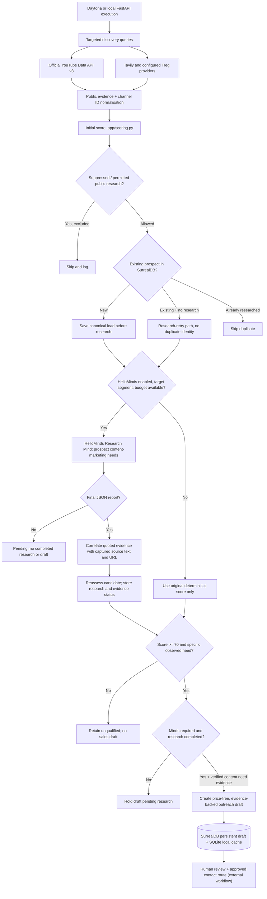
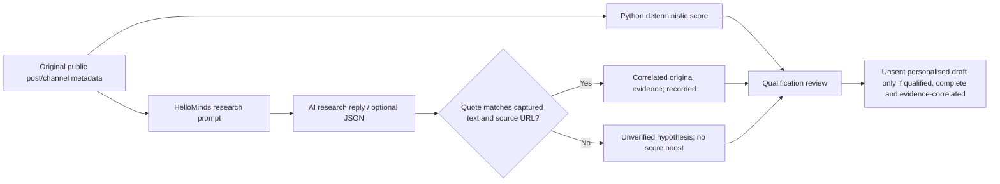
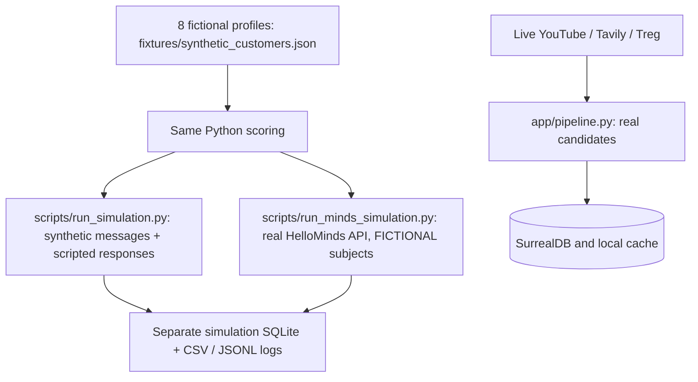

# Customer acquisition pipeline — content marketing subscription

**Version:** 11 November 2026 — verified-research outreach update  
**Role:** Find and qualify potential subscribers; research their needs; prepare outreach drafts. **No messages are sent.**  
**Offer:** £7/month for daily social-media insights, competitor and hot-topic monitoring, and ready-to-post content suggestions. Subscriber account analysis and content generation belong to the other project workstreams and are **not implemented here**.

## Figure 1. Updated live acquisition flow



**Figure legend:** Rectangles = pipeline modules and outside services; diamonds = decisions; database cylinders = saved data; solid arrows = program control/data transfer. The customer messaging step is **outside** this application. `app/pipeline.py` orchestrates discovery, scoring, suppression, research, draft preparation and persistence. An existing prospect with no research can be researched on a later run, without duplicating a lead.

## Scoring model (100 points)

| Score component | Maximum | Evidence examples |
|---|---:|---|
| Observed social-media/content pain | 30 | Explicit statements about needing content ideas, poor engagement, social media planning or competitor content |
| Target customer segment | 20 | Small business, early-stage startup or influencer; keyword-inferred and subject to verification |
| Recurring content need | 20 | Daily/weekly posting, content calendar, ongoing competitor monitoring |
| Commercial proxy | 10 | A credible business/creator presence and publicly provided website |
| Recent activity | 10 | Source dated within the preceding 30 days (not merely any timestamp) |
| Public business route | 5 | Website or public creator/business profile (not necessarily permission to message) |
| Evidence confidence | 5 | Quality of supplied public evidence metadata |
| **Total** | **100** | Score is not a conversion probability |

Numerical qualification requires a score of at least 70, an enabled target segment, and an explicit recognised need in the prospect's **original captured evidence**. An AI-generated claim does **not** automatically increase the score. This prevents an unsupported model statement from becoming permission to contact somebody.

### Research-first behaviour

- When `MINDS_ENABLED=true`, HelloMinds receives **new segment-matched leads even if their initial score is below 70**. This includes the low-scoring YouTube channel candidates observed during the user's earlier test.
- The request asks specifically about content creation challenges, engagement, ongoing posting, trends, competitors and the potential usefulness of ready-to-post ideas—not generic market reports.
- The adapter requires a final JSON object with `status: "completed"`, nonempty `summary`, `content_challenges` array, `limitations` array, and `evidence` array. A reply promising research later is `pending` (not completed), and malformed/incomplete JSON is `invalid`. Neither is saved as a completed research brief or used for drafting.
- A quoted excerpt is correlated only when it occurs in the **already captured** public text and cites that captured source URL. This is **not proof of independent verification**. Research from newly discovered URLs requires separate source retrieval and validation before it can influence scoring.
- Only a validated **completed** Mind report is saved in `research_briefs` and, when enabled, SurrealDB. A `pending` Mind acknowledgement increments `research_pending` but not `researched`. For automatic research with Minds enabled, no draft is made unless the prospect is already qualified **and** the completed report contains at least one source-correlated content-need quote.
- With HelloMinds disabled, deterministic scoring and draft preparation continue locally.
- Saved existing records do not automatically get duplicate drafts; a previously interrupted research operation can be retried.

## Figure 2. Research and review boundary



**Figure legend:** A diamond indicates a validation gate, not an external URL verification service. Research can support a human reviewer by describing a potential need; it cannot independently prove the customer wants to subscribe.

## Figure 3. Simulation and real-world separation



**Figure legend:** The upper branch **never contacts real customers**; the optional Minds simulation contacts only HelloMinds, not fictional businesses. The lower live branch discovers real public accounts but also does not send messages. Simulation data is not hackathon revenue.

## Exact HelloMinds live test (Mac/local, before Daytona)

1. In the project `.env`, set:

   ```dotenv
   MINDS_ENABLED=true
   MINDS_BUILDER_API_KEY=your_real_builder_key
   MINDS_RESEARCH_MIND_ID=your_real_mind_uuid
   MINDS_MAX_RESEARCH_PER_RUN=2
   ```

   Keep the credentials private. Install Python requirements and Node.js 22+ and install the bridge dependencies:

   ```bash
   python -m pip install -r requirements.txt
   cd bridge && npm install && cd ..
   ```

2. Start the API (choose a free port):

   ```bash
   python -m uvicorn app.main:app --host 127.0.0.1 --port 8001
   ```

   Open `http://127.0.0.1:8001/docs`. Confirm `GET /health` works. If `AGENT_API_KEY` is set, requests require its configured `X-Agent-Key` header.

3. Use `GET /leads` to identify the **local SQLite integer ID** of a prospect, including an unqualified YouTube lead. Previously observed IDs (e.g. `8`) only apply to the local SQLite database that generated them; they may differ after a restart, data import or Daytona sandbox. Do **not** use a YouTube channel ID in the numeric route.

4. Expand `POST /research/{lead_id}/run` in Swagger, click **Try it out**, enter the local lead ID, then **Execute**. Example request (change `8` to a real ID from `GET /leads`):

   ```bash
   curl -X POST http://127.0.0.1:8001/research/8/run
   ```

   The route can research leads below the qualification threshold. It refuses a suppressed prospect. When HelloMinds sends a completed structured report, the response includes `research_status: "completed"`, `qualification` and `outreach_sent: false`; results are saved in `GET /research` and canonical SurrealDB records. If the Mind only acknowledges the request, the response has `research_status: "pending"`, `research_completed: false` and **no new completed research brief is saved**. If the Mind supports later completion, retrieve the actual completed reply through its supported conversation workflow before rerunning; this app does not automatically poll for a later reply.

5. Check `GET /research` and, if SurrealDB is enabled, check `research_briefs` in your **production** database (selected namespace and database must match `.env`). Do **not** confuse this with the separate `integration_test` database used for destructive CRUD tests.

6. For automated research during discovery, submit `POST /agent/run` with a new search query and `platforms: ["youtube_direct"]`. Observe `researched`, `research_pending`, `research_assessed`, `drafts`, and `errors`; normal unqualified leads can now be researched, constrained by `MINDS_MAX_RESEARCH_PER_RUN`. Already-researched identities are skipped on subsequent discovery runs.

**Troubleshooting:** `502` means the Research Mind or persistence call failed; inspect server logs and the Mind's configured API access. `404` means the local lead ID does not exist. `409` means the prospect is suppressed. An ordinary successful research reply may still leave the prospect unqualified. The service sends **no** customer messages.

### Direct HelloMinds simulation with fictional customers

```bash
python -m scripts.run_minds_simulation --max-research 2
```

This uses real HelloMinds credits, but fictional research subjects and scripted customer responses. Use `python -m scripts.run_simulation` for completely offline, repeatable tests. For Daytona, use the existing `scripts/run_daytona.py` runner described in `docs/DAYTONA_DEPLOYMENT_READINESS.md`.

## Test commands and production limitations

```bash
python -m pytest -q
python -m pytest -q tests/test_acquisition_research_first.py
```

All external services are mocked in the default suite. Opt-in live tests need their own credentials and **test-only** SurrealDB database. The current app is not a sales sender and does not implement Stripe, subscriber analysis, daily delivery, or publishing ready-to-post content. It does **not** independently verify every HelloMinds citation, and heuristics can still classify content creators or media channels incorrectly. Review business identities and platform permissions before any outreach.

## Outreach message rules (11 November update)

- **No price appears in outreach drafts.** Price stays in internal configuration/billing records and is deliberately never added to the subject or message. Do not copy old persisted draft messages without reviewing them: the update does not retroactively rewrite previously stored drafts in SurrealDB or SQLite.
- A completed HelloMinds report's `evidence` array must quote a content-marketing need present verbatim in the matching original captured source (`source_url` + signal; profile URL + description). Only such source-correlated findings are passed to `create_draft(..., assessment=...)`.
- If research is incomplete or no source-correlated findings exist, **the research-first pipeline does not create a new automated draft** (even for an otherwise qualified lead). If Minds is deliberately disabled, a generic unsent draft can still be created with deterministic scoring, but no research-derived claims are included.
- Every draft requires human review, a checked public contact route, compliance approval, and opt-out handling before anyone sends it using a separate permitted system. No outbound sender is included.
- A price-free generic draft may mention the offered features but must never imply verified pain or buyer interest.

### Manual HelloMinds test using your existing local lead ID

Run `POST /research/9/run` in Swagger, replacing `9` if your current SQLite lead ID differs. A response like `On it... expect the brief in 10-15 minutes` now has `research_status: pending` and `research_completed: false`, not a misleading success label. For completed JSON, look for `status: "completed"`, structured sources, and then inspect `qualification.assessment.verified_findings` and `evidence_accepted`. `GET /research` only lists completed research briefs. The Mind's own claimed sources are not sufficient unless they can be matched to the captured original source text.
