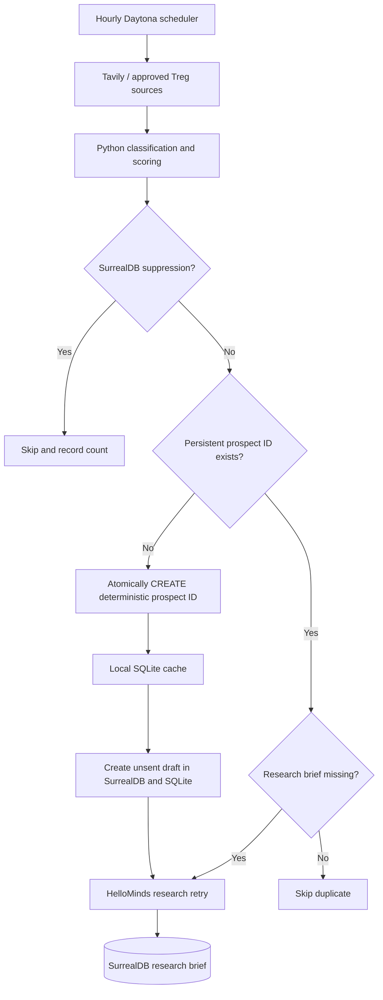

# SurrealDB persistence, Daytona restarts and test guide

## Overview

This branch moves the **live acquisition path** from blind SQLite mirroring to
**SurrealDB-first identity and suppression checks** whenever `SURREAL_ENABLED=true`.
The agent stores a canonical prospect record using a stable SHA-256 record ID
before writing to local SQLite. A second Daytona sandbox checks that persistent
record ID and will not create another outreach draft. Opt-outs are written to
SurrealDB before any local confirmation. Research briefs and unsent drafts are
stored under the same stable prospect identity. The HelloMinds research step can
retry on a later run if the prospect exists but no remote research brief was saved.

**Important:** This is an incremental hardening step, not certification for
production. SQLite is still a local cache for `/leads`, `/drafts`, opportunities,
and other endpoints. `/persistent/leads` reads SurrealDB records across sandboxes.
The current pipeline generates draft text before HelloMinds research; no messages
are sent. Subscription billing, daily delivery, backup/restore, access reviews,
large-table pagination, observability and deployment monitoring still need work.



## Your existing Cloud configuration

Your Studio screenshot showed the **Amplify** Cloud *instance* with **namespace
`main` and database `main`**. Verify the actual connection URL and the database
user credentials independently:

```dotenv
SURREAL_ENABLED=true
SURREAL_URL=wss://your-native-surrealdb-endpoint
SURREAL_NAMESPACE=main
SURREAL_DATABASE=main
SURREAL_USERNAME=your_database_user
SURREAL_PASSWORD=your_database_user_password
```

Never use a `postgresql://` URL in the native SurrealDB Python SDK. Do not commit
`.env`, publish credentials, or embed them in Daytona source files. Prefer a
dedicated database-scoped, least-privilege user and encrypted secret injection.

## Run local unit/integration tests safely

From the project root:

```bash
python -m pip install -r requirements.txt
python -m pytest -q
```

`tests/test_persistence_end_to_end.py` uses a **fake persistent SurrealDB store**
that survives simulated Daytona sandbox restarts. It tests:

1. New lead -> durable prospect, unsent draft and research records.
2. Second sandbox -> no duplicate prospect, draft or HelloMinds request.
3. Opt-out -> suppression survives fresh SQLite cache and blocks discovery.
4. Storage outage -> stops processing before any local write or research call.
5. Failed suppression storage -> API responds HTTP 503 rather than false success.
6. Research interruption -> next run retries only missing research.
7. Canonical URL variants -> consistent identity and deduplication.

These tests do not spend credits or access your Cloud instance. They exercise
the live orchestration with a faked store and mocked discovery/research.

## Migrate an existing SQLite-only sandbox before recurring deployment

If you already have local leads or suppression records, copy those **before**
enabling hourly disposable Daytona sandboxes:

```bash
python -m scripts.migrate_sqlite_to_surreal
# Review the counts; only then run:
python -m scripts.migrate_sqlite_to_surreal --apply
```

The migration writes suppressed identities first, then attempts unique prospect
claims using deterministic record IDs. It is idempotent. It does **not** migrate
previous SQLite research briefs, subscription opportunities, audit events or
message history. Back up your current database and reconcile those records
separately before abandoning local storage.

## Optional live SurrealDB CRUD verification

**Do not run this test against your `main` production database.** First create a
separate namespace/database with a name such as `integration_test` and grant a
dedicated test user CRUD permissions. Update your shell or test-only `.env` so
`SURREAL_DATABASE=integration_test`. Only then explicitly opt in:

```bash
RUN_SURREAL_INTEGRATION=yes python -m pytest -q tests/test_surreal_live_integration.py -rs
```

The live test checks a unique fictional lead, reads it back, creates a
suppression, research brief and unsent draft, reconnects to verify persistence,
then deletes its four test records. It refuses to run against databases without
a test-appropriate name. **It does not call HelloMinds, YouTube or Tavily.**
A failed cleanup can leave synthetic test records, so inspect the test database
if the test fails partway through.

### Verify deployed API

Start FastAPI with a configured persistent database:

```bash
uvicorn app.main:app --host 0.0.0.0 --port 8000
```

Call authenticated `GET /persistence/status` and `GET /persistent/leads`. The
former verifies the server can authenticate to SurrealDB; the latter lets you
see leads persisted by earlier Daytona runs. `GET /leads` still queries the
current sandbox's local SQLite cache.

## Tables

With a non-strict, schemaless database and suitable privileges, records can be
created automatically. Required tables are **normal tables**, not relation
tables: `prospects`, `research_briefs`, `outreach_drafts`, `suppression`.
The existing subscription opportunity API also mirrors a record into
`subscription_opportunities`; audit and opportunity hardening is not yet
complete. On a STRICT database, create the tables explicitly in the TEST and
production namespaces before executing the tests or agents.

## Operational safeguards before production

- Keep **automated sending disabled** and request channel approval before
  contacting strangers.
- Keep all real lead and suppression state in persistent storage; migrate any
  preexisting SQLite-only suppressed identities to SurrealDB before switching
  to short-lived Daytona jobs.
- Provision a separate test namespace/database; never point the live CRUD test
  at production.
- Use a single scheduled writer initially; deterministic SurrealDB record IDs
  provide a server-side uniqueness guard, but complete job leasing, retries,
  rate limits, disaster recovery and worker coordination are separate work.
- Keep the database accessible from Daytona; `localhost` points to the sandbox,
  not your Cloud instance.
- Back up SurrealDB; confirm database retention and quotas; instrument API usage
  costs for your £7/month subscription.
- Consider a full SurrealDB-backed CRM API and remote opportunities/audit event
  handling before removing SQLite or increasing concurrency.
