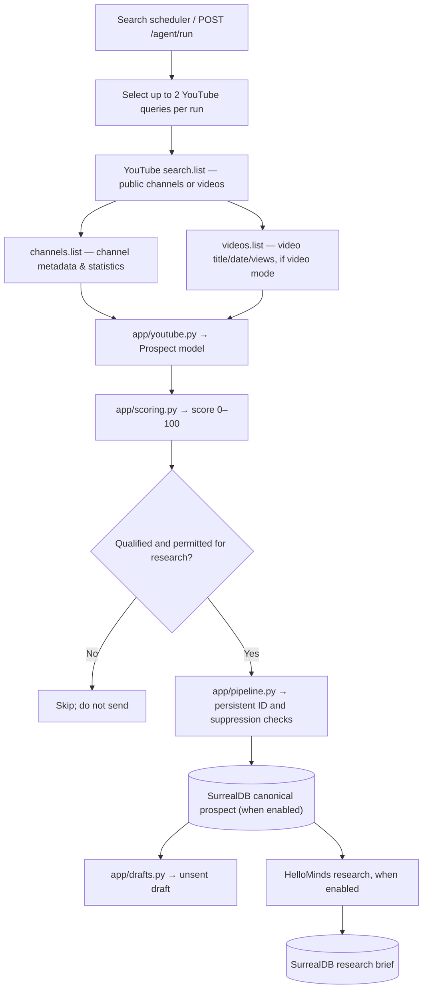

# Official YouTube Data API v3 discovery

**Status:** Integrated in this codebase; unit/integration tests use mocked HTTP responses and a mocked SurrealDB/HelloMinds provider. The real API smoke test is opt-in and has **not** been run with the user's API key. No YouTube messages or automatic sales outreach are sent.

## Architecture



**Legend:** Solid arrows = logical data or control flow; cylinder = persisted data; diamond = decision. The two branches from the persisted lead are not ordered as drawn: the current code drafts **before** HelloMinds research and does not automatically rewrite the draft using research. With SurrealDB disabled, SQLite is used locally; do not rely on that database surviving a disposable Daytona sandbox.

## Enable

Set in `.env` or Daytona's secrets:

```dotenv
YOUTUBE_ENABLED=true
YOUTUBE_API_KEY=YOUR_GOOGLE_CLOUD_API_KEY
YOUTUBE_SEARCH_TYPE=video
YOUTUBE_ENRICH_VIDEOS=true
YOUTUBE_MAX_SEARCHES_PER_RUN=2
YOUTUBE_MAX_SEARCHES_PER_DAY=80
YOUTUBE_QUOTA_DB_PATH=./data/youtube_quota.sqlite3
```

You need a Google Cloud project with YouTube Data API v3 enabled. A key authorises reads of **public data**; OAuth is only needed for private/account-specific actions. Do not commit the API key. Restrict the key to YouTube Data API v3 and appropriate server egress IPs where practical. Never place keys in URLs printed in logs.

`YOUTUBE_SEARCH_TYPE=video` searches public videos and enriches both videos and the owning channels. `YOUTUBE_SEARCH_TYPE=channel` searches public channel descriptions and does not make `videos.list` calls. The current connector performs **one search page per query** and up to one batched `channels.list` and one batched `videos.list` request; it does not fetch comments, emails, subscribers' identities or private data.

## Use

Install Python dependencies:

```bash
python -m pip install -r requirements.txt
```

First test a single real search safely (one `search.list` call):

```bash
python -m scripts.youtube_smoke --query "small business owner ecommerce trends" --limit 3
```

Or run the credential-gated pytest (only when API key is configured):

```bash
RUN_YOUTUBE_SMOKE=yes python -m pytest -q tests/test_youtube_live_smoke.py -rs
```

Run the full pipeline locally or inside Daytona, after configuring SQLite/SurrealDB and optionally HelloMinds:

```bash
uvicorn app.main:app --host 0.0.0.0 --port 8000
```

At `http://localhost:8000/docs`, call `POST /agent/run` with:

```json
{"queries": ["indie founder startup daily competitor research"],
 "platforms": ["youtube_direct"], "max_results_per_query": 5}
```

If `platforms` and `queries` are empty, the pipeline automatically includes `youtube_direct` when configured and rotates its two YouTube query choices per hour. If `platforms` is explicitly set, the agent does not add YouTube on its own. The Treg-managed `youtube` provider remains separate from `youtube_direct`.

Inspect `/config/platforms`, `/leads`, and (if SurrealDB enabled) `/persistent/leads`. Search candidates are not verified customers; review channel ownership, evidence relevance, and permission to use data before any outreach.

## Data and scoring

- Each prospect is identified by its **immutable YouTube channel ID**, represented by `https://www.youtube.com/channel/UC...`. `lead_identity()` and the local SQLite deduplication key both use this channel identity, even when a channel advertises a website or several videos appear across runs.
- `source_url` links to the exact public video (when video mode is selected). `profile_url` links to the channel. The website is extracted only when explicitly present in the channel description; it is **not** invented from an unrelated video.
- `raw` carries the channel ID, optional video ID, video title, publication date, and available public counts. Hidden subscriber counts are allowed.
- `app/scoring.py` computes the same 100-point heuristic used elsewhere, with YouTube-specific evidence reasons. It treats a video date older than 30 days as insufficient evidence of recent activity. Subscriber counts do **not** increase the lead score. A keyword match does not prove that a channel wants to buy.
- Unverified or weakly matched candidates are excluded from qualification; all outbound messages remain drafts requiring human review and channel approval.
- When SurrealDB is enabled, the pipeline checks suppression and deterministic persistent IDs across Daytona sandbox restarts, prevents duplicate drafts, and stores optional HelloMinds research for qualified leads.

## Quota and costs

Google's published quotas at the time this connector was written: a default separate daily bucket of **100 `search.list` calls**, with a **10,000 general units/day** allowance for other endpoints, including `channels.list` and `videos.list`. Each search call consumes 1 search call, including unsuccessful requests. Confirm your own project limits in Cloud Console; usage resets at midnight Pacific Time.

- `YOUTUBE_MAX_SEARCHES_PER_RUN=2` limits the total number of direct YouTube searches in one pipeline invocation, even if many default queries exist. At 24 runs per day, that is at most 48 calls/day *if no retries or other instances are running*.
- `YOUTUBE_MAX_SEARCHES_PER_DAY=80` caps search calls **only within one persistent local quota ledger** (`YOUTUBE_QUOTA_DB_PATH`) and reserves calls before sending requests.
- **Important Daytona limitation:** a fresh ephemeral sandbox has a fresh local quota ledger. Two sandboxes cannot enforce a shared daily cap. Before scheduling multiple ephemeral Daytona jobs, use a central atomic daily counter/lease, e.g. SurrealDB or a shared scheduler, or restrict a single orchestrator to 2/hour and do not run other clients on the project. Otherwise quota overruns remain possible.
- SDK-generated API errors are recorded in the pipeline's `errors` array without showing the API key; `403/429` is treated as a quota or permission error.

## Tests

Run `python -m pytest -q` to verify mocked `search.list`, `channels.list`, `videos.list`, stable channel identity, query rotation, quota reservation, 403 handling, and full pipeline handoff to mocked SurrealDB plus mocked HelloMinds with deduplication across simulated Daytona restarts. A separate live smoke test is skipped unless `RUN_YOUTUBE_SMOKE=yes` is explicitly set.

## Deployment constraints

1. Store `YOUTUBE_API_KEY` and other secrets only in Daytona's secret injection, never in the ZIP or source control.
2. Prepare the database schema and ensure the `prospects`, `suppression`, `research_briefs`, and `outreach_drafts` tables exist when using SurrealDB.
3. Schedule one worker at a time; confirm YouTube and HelloMinds external permissions, SurrealDB durability, retry limits, and provider spend before enabling hourly production operation.
4. The application **does not** create Stripe subscriptions, send YouTube messages, or guarantee that public YouTube channels are genuine businesses.
5. Follow Google's YouTube API Services Terms and Developer Policies, including restrictions on storage, display, use and retention of API data. Review these before storing channel/video metadata for commercial prospecting.

Official sources: https://developers.google.com/youtube/data/determine_quota_cost and https://developers.google.com/youtube/data/reference/rest/v3/search/list
